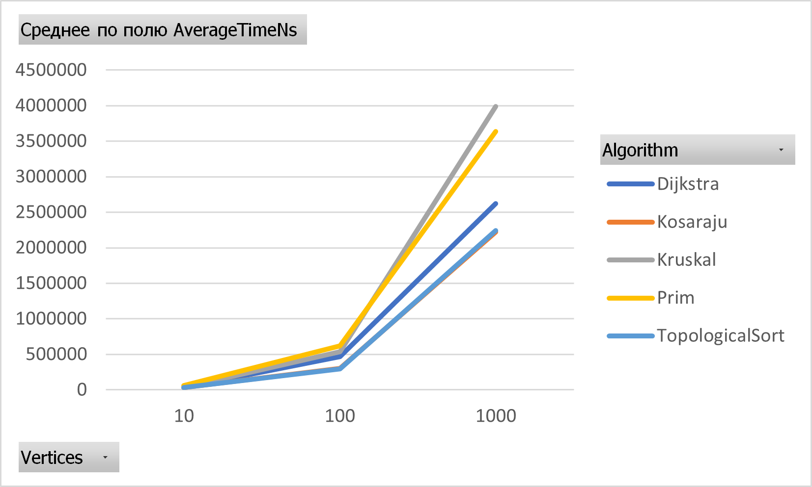
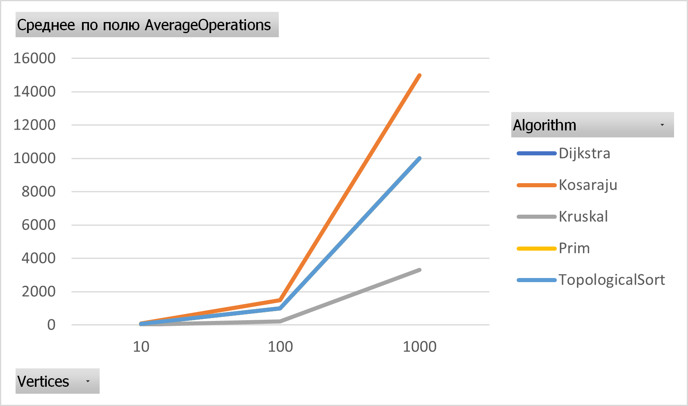

## Smart City Infrastructure and Route Planning

## Project Overview
This project implements and evaluates graph algorithms for smart city infrastructure and route planning.
Graphs are used to represent connections between locations, roads, infrastructure networks, and dependencies. 
The project demonstrates how graph algorithms can solve problems such as finding minimum-cost infrastructure networks, calculating shortest routes, identifying strongly connected regions, and determining valid task execution orders.

## Implementation
Five algorithms were implemented:
- Kruskal - finds a minimum spanning tree using sorted edges and Disjoint Set Union (DSU) with path compression and union by rank.
- Prim - finds a minimum spanning tree using a priority queue.
- Topological Sort - uses Kahn's algorithm to order vertices in a DAG and detect cycles.
- Kosaraju - identifies strongly connected components using two DFS passes.
- Dijkstra - calculates shortest paths using a priority queue and supports path reconstruction.
- 
The project also includes GraphGenerator for generating test graphs, AlgorithmTests for correctness testing, and Benchmark for performance measurements.

## Complexity Analysis
| Algorithm | Time Complexity | Auxiliary Space |
|---|---|---|
| Kruskal | O(E log E) | O(V + E) |
| Prim | O(E log V) | O(V + E) |
| Topological Sort | O(V + E) | O(V) |
| Kosaraju | O(V + E) | O(V + E) |
| Dijkstra | O((V + E) log V) | O(V + E) |

## Experimental Setup
Connected undirected weighted graphs were generated for Kruskal, Prim, and Dijkstra. Directed graphs were generated for Kosaraju, and DAGs for Topological Sort.
Graph generation used fixed random seeds. Each algorithm was measured five times per graph size, after warm-up runs.
The benchmark recorded average execution time in nanoseconds and average edge examinations.

| Graph Size | Vertices | Edges |
|---|---:|---:|
| Small | 10 | 30 |
| Medium | 100 | 500 |
| Large | 1000 | 5000 |

## Results
Average Execution Time(ms)

| Algorithm | V=10 | V=100 | V=1000 |
|---|---:|---:|---:|
| Kruskal | 0.03622 | 0.53444 | 3.98950 |
| Prim | 0.06132 | 0.61822 | 3.63890 |
| Topological Sort | 0.03330 | 0.29618 | 2.23936 |
| Kosaraju | 0.03318 | 0.30320 | 2.22492 |
| Dijkstra | 0.03428 | 0.46998 | 2.62474 |

Average Edge Examinations

| Algorithm | V=10 | V=100 | V=1000 |
|---|---:|---:|---:|
| Kruskal | 10.60 | 208.60 | 3317.60 |
| Prim | 60 | 1000 | 10000 |
| Topological Sort | 60 | 1000 | 10000 |
| Kosaraju | 90 | 1500 | 15000 |
| Dijkstra | 60 | 1000 | 10000 |

## Comparison and Discussion
Execution time increased with graph size, as expected from the theoretical complexities.
For 1000 vertices, Prim - 3.64 ms was slightly faster than Kruskal -3.99 ms. Topological Sort- 2.24 ms and Kosaraju - 2.22 ms showed similar execution times, consistent with their linear complexity.
The operation counts also increased with graph size. Kosaraju recorded approximately 3E edge examinations, while Topological Sort recorded 2E. 
Prim and Dijkstra examined both adjacency directions of undirected edges.
Kruskal examined fewer edges because it can stop after constructing the MST. However, its counter does not include sorting comparisons.

## Testing

| Test | Expected Result |
|---|---|
| Kruskal MST | Weight 19, 3 edges |
| Prim MST | Weight 19, 3 edges |
| Disconnected MST | Disconnection detected |
| Topological Sort DAG | Valid ordering |
| Topological Sort Cycle | Cycle detected |
| Kosaraju SCC | Correct SCC groups |
| Dijkstra Shortest Paths | Correct distances and path |
| Dijkstra Unreachable | Unreachable vertex detected |
| Dijkstra Negative Weight | Exception thrown |

## Conclusion
All five graph algorithms were implemented and tested successfully. 
Experimental results showed increasing execution time and edge examinations as graph size increased.
Kruskal and Prim are appropriate for minimum-cost infrastructure networks, Dijkstra for shortest routes, Topological Sort for dependency scheduling, and Kosaraju for identifying strongly connected regions.